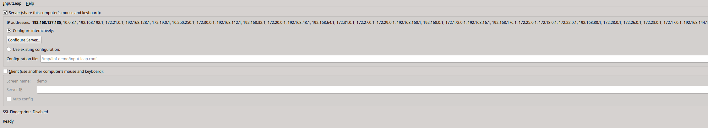
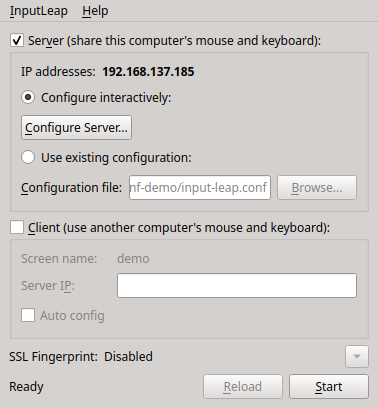

# Input Leap Network Filter

**English** · [Português (Brasil)](README.pt-BR.md)

Lightweight network interface filtering for [Input Leap](https://github.com/input-leap/input-leap)
on Linux. Hide Docker, LXC and other virtual network addresses from the Input
Leap window **without touching system networking, stopping containers or
recompiling Input Leap**.

> Independent project. Not affiliated with, endorsed by or maintained by the
> Input Leap or Qt projects.

## The problem

On machines with Docker, LXC, libvirt, Kubernetes and friends, the Input Leap
GUI lists every IP address of every bridge. The window becomes wider than the
screen.

**Before** — 36 addresses, window 2587 px wide (cropped):



**After** — only the real network, window 378 px wide:



Screenshots taken on the maintainer's Ubuntu 22.04 machine with Input Leap
3.0.3 (Qt 6.2.4), same configuration, without and with the filter.

## How it works

A tiny library is loaded **only into the Input Leap GUI process** with
`LD_PRELOAD`. It wraps Qt's `QNetworkInterface::allAddresses()`: it calls the
original function and removes the addresses that belong only to the
interfaces you chose to hide. Networks, routes, firewall, DNS, containers and
every other program are not affected. The library removes itself from
`LD_PRELOAD` right after loading, so `input-leaps`/`input-leapc` do not
inherit it.

Details: [docs/how-it-works.md](docs/how-it-works.md).

## Quick install

```bash
git clone https://github.com/dansp89/input-leap-network-filter.git
cd input-leap-network-filter
bash install.sh
```

Then restart Input Leap. The installer:

1. finds Input Leap (or use `--path /path/to/input-leap`) and the Qt version
   it uses, by static analysis (the binary is never executed);
2. asks before installing missing build tools with `sudo`;
3. builds the library for that Qt version, validates it in a test process and
   only then activates it;
4. puts a wrapper in front of Input Leap, so the terminal, the application
   menu and autostart all get the filter.

You do not need to know C++, Qt or `LD_PRELOAD`.

### Manual install

```bash
make build            # or: make build QT=5
make test
./bin/input-leap-network-filter install --verbose
```

### Install from a release

Download `input-leap-network-filter-X.Y.Z.tar.gz` and `SHA256SUMS` from the
[Releases](https://github.com/dansp89/input-leap-network-filter/releases)
page, check and inspect before running anything:

```bash
sha256sum -c SHA256SUMS
tar -xzf input-leap-network-filter-X.Y.Z.tar.gz
less input-leap-network-filter-X.Y.Z/scripts/lib/ops.sh   # read what it does
bash input-leap-network-filter-X.Y.Z/install.sh
```

## Usage

```bash
input-leap-network-filter                 # interactive menu
input-leap-network-filter preview         # what Input Leap will show
input-leap-network-filter interfaces      # every interface, kind and decision
input-leap-network-filter doctor          # diagnostics
input-leap-network-filter disable         # turn off (applies on next start)
input-leap-network-filter enable
```

| Command | Description |
| --- | --- |
| `install` | build, validate and activate (safe to repeat) |
| `uninstall [--purge]` | restore the original state; `--purge` also removes config, state and backups |
| `update` | check GitHub Releases, verify SHA-256, install only after confirmation |
| `enable` / `disable` | toggle the filter without uninstalling |
| `status` | installation state |
| `doctor` | full diagnostics |
| `repair` | fix what can be fixed safely (missing library, overwritten wrapper, interrupted install) |
| `rollback` | return to the previous library build |
| `interfaces` / `preview` | inspect interfaces and the effect of the configuration |
| `configure` | change configuration (see below) |
| `reset` | default configuration (old one is backed up) |
| `version` / `help` | |

Global options: `--help`, `--version`, `--verbose`, `--quiet`, `--debug`,
`--dry-run`, `--non-interactive`, `--yes`, `--no-color`, `--json`,
`--path FILE`, `--lang en|pt_BR|es`.

With `--json`, stdout contains only JSON (`status`, `doctor`, `interfaces`,
`preview`, `version`, `update`).

Exit codes: `0` ok · `1` error · `2` usage · `3` not installed / Input Leap not
found · `4` unsupported installation · `5` missing dependency · `6`
conflict/integrity · `7` build or validation failed · `8` another instance
running · `10` doctor found problems.

`doctor` example (real output, some lines omitted):

```text
[OK]   Operating system: Ubuntu 22.04.5 LTS (Tested)
[OK]   Architecture: x86_64
[OK]   Qt6 detected (system 6.2.4)
[OK]   Filter library integrity verified
[OK]   Wrapper verified
[OK]   Original executable preserved
[OK]   Filter enabled
...
Physical interfaces: 2
Virtual interfaces detected: 63
Interfaces selected for filtering: 62

Status: Healthy
```

## Configuration

`~/.config/input-leap-network-filter/config.toml`:

```toml
[filter]
enabled = true
mode = "denylist"            # denylist | allowlist | off

[interfaces]
profiles = ["docker", "lxc"] # also: lxd incus podman kubernetes libvirt openvswitch
exclude = []                 # extra names or globs to hide
include = []                 # always shown, wins over everything

[logging]
enabled = false
level = "warn"
```

```bash
input-leap-network-filter configure --add-exclude 'virbr*'
input-leap-network-filter configure --profiles docker,lxc,libvirt
input-leap-network-filter configure --add-include br-home
```

VPNs (WireGuard, Tailscale, ZeroTier), VLANs, tunnels, Ethernet and Wi-Fi are
never hidden by default, and private address ranges are never used as a
reason to hide anything. An invalid file disables filtering instead of
breaking Input Leap. Full reference: [docs/configuration.md](docs/configuration.md).

## Compatibility

| Distribution | Level |
| --- | --- |
| Ubuntu 22.04 LTS | **Tested** |
| Ubuntu 24.04/26.04, Debian, Linux Mint, Pop!_OS | Experimental (APT adapter) |
| Fedora, Rocky Linux, AlmaLinux | Experimental (DNF/YUM adapter) |
| Arch Linux, Manjaro, EndeavourOS | Experimental (Pacman adapter) |
| openSUSE | Experimental (Zypper adapter) |

*Experimental* means the code supports it but nobody has confirmed it yet.
Please send a [compatibility report](.github/ISSUE_TEMPLATE/compatibility_report.md).

| Input Leap installed as | Support |
| --- | --- |
| Local binary / built from source / GitHub release binary in your home | ✅ in-place wrapper |
| Distribution package (APT, RPM, Pacman), `/usr/bin`, `/usr/local/bin`, `/opt` | ✅ external wrapper + desktop entries (binary untouched) |
| Flatpak, Snap | ❌ refused: would require bypassing the sandbox |
| AppImage | ❌ refused: bundles its own Qt |

Both Qt 5 and Qt 6 builds of Input Leap are supported; the test suite runs
against both.

## Known limitations

- Changes apply when Input Leap starts; restart it after
  installing/enabling/disabling.
- With a package-managed Input Leap, launching the binary by its full path
  (`/usr/bin/input-leap`) bypasses the wrapper. Menu entries, autostart and
  `input-leap` on your `PATH` are covered.
- If you install a new Input Leap build by copying it over the wrapper, the
  filter stops until you run `input-leap-network-filter repair`
  (`doctor` tells you).
- Only the GUI address list is filtered. What the server listens on is
  unchanged (that is intended).
- The automated tests use a small Qt test program, not a real graphical
  Input Leap session. The real session was checked manually on Ubuntu 22.04.

## Updating

```bash
input-leap-network-filter update      # asks before installing
# or, from a git clone:
git pull && bash install.sh
```

Nothing updates by itself, and nothing runs in the background. Without
internet the installed version keeps working.

## Uninstalling

```bash
input-leap-network-filter uninstall           # keeps your configuration
input-leap-network-filter uninstall --purge   # removes everything from this project
```

The original executable goes back to its place, desktop entries are restored,
and Input Leap's own settings are never touched. Build dependencies installed
through your package manager are not removed.

## Security

Runs as your user, never as root; no global `LD_PRELOAD`, no
`/etc/ld.so.preload`; no telemetry; the library is only preloaded if it is
owned by you and not writable by others. See [SECURITY.md](SECURITY.md).

## Development

```bash
make test      # C++ unit tests, library test, 61 end-to-end CLI checks
make lint      # shellcheck
make bench
```

See [CONTRIBUTING.md](CONTRIBUTING.md). Changes: [CHANGELOG.md](CHANGELOG.md).

## License

[MIT](LICENSE). Qt is used under its LGPL terms through dynamic linking; no
Input Leap code is included. See [THIRD_PARTY_NOTICES.md](THIRD_PARTY_NOTICES.md).
