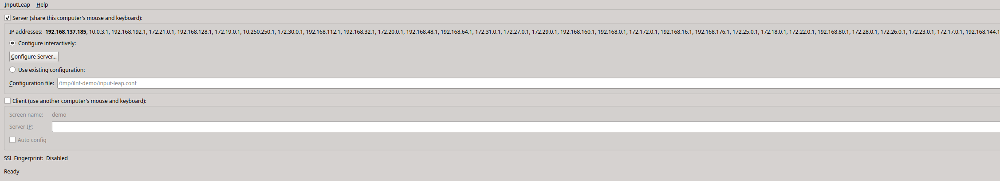
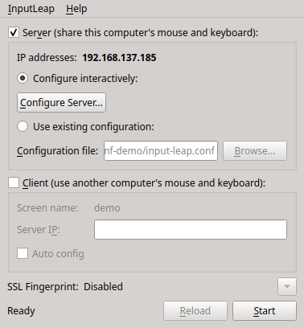

# Input Leap Network Filter

[English](README.md) · **Português (Brasil)**

Filtro leve de interfaces de rede para o [Input Leap](https://github.com/input-leap/input-leap)
no Linux. Esconde da janela do Input Leap os endereços do Docker, LXC e de
outras redes virtuais **sem mexer na rede do sistema, sem parar containers e
sem recompilar o Input Leap**.

> Projeto independente. Não tem vínculo oficial com os mantenedores do Input
> Leap nem do Qt.

## O problema

Em máquinas com Docker, LXC, libvirt, Kubernetes e afins, a interface do
Input Leap lista o IP de cada bridge. A janela fica mais larga que a tela.

**Antes** — 36 endereços, janela com 2587 px de largura (recortada):



**Depois** — só a rede de verdade, janela com 378 px:



Prints tirados na máquina do mantenedor (Ubuntu 22.04, Input Leap 3.0.3,
Qt 6.2.4), mesma configuração, sem e com o filtro.

## Como funciona, em uma frase

Uma bibliotequinha é carregada **só no processo da interface gráfica do Input
Leap** (via `LD_PRELOAD`) e substitui a função do Qt
`QNetworkInterface::allAddresses()`: ela chama a função original e tira da
lista apenas os endereços das interfaces que você escolheu esconder.

O que **não** acontece:

- nenhuma interface é apagada ou desligada;
- nada de `docker network prune`, nada de parar containers ou serviços;
- firewall, DNS e rotas ficam como estão;
- o Input Leap não é recompilado nem alterado; as bibliotecas do Qt também não;
- nada de `/etc/ld.so.preload` ou `LD_PRELOAD` global;
- o servidor/cliente (`input-leaps`/`input-leapc`) não herda o filtro: a
  biblioteca se remove do `LD_PRELOAD` assim que carrega.

Detalhes técnicos (em inglês): [docs/how-it-works.md](docs/how-it-works.md).

## Instalação rápida

```bash
git clone https://github.com/dansp89/input-leap-network-filter.git
cd input-leap-network-filter
bash install.sh
```

Depois, feche e abra o Input Leap de novo (inclusive pelo ícone da bandeja).

O instalador faz sozinho:

1. acha o Input Leap (ou use `--path /caminho/do/input-leap`) e descobre se ele
   usa Qt5 ou Qt6 — por análise estática, o programa não é executado;
2. se faltar compilador ou pacote de desenvolvimento do Qt, **pergunta** antes
   de rodar `sudo apt-get install` (ou dnf/pacman/zypper);
3. compila a biblioteca, testa ela num processo Qt de teste e só então ativa;
4. coloca um wrapper na frente do Input Leap, para valer no terminal, no menu
   de aplicativos e na inicialização automática.

Não precisa saber C++, Qt nem `LD_PRELOAD`.

Já usava a correção manual (o script `~/.local/bin/input-leap` que exportava
`LD_PRELOAD` e chamava `input-leap.original`)? O instalador reconhece,
guarda uma cópia e migra para a versão gerenciada.

## Uso do dia a dia

```bash
input-leap-network-filter                 # menu interativo
input-leap-network-filter preview         # o que o Input Leap vai mostrar
input-leap-network-filter interfaces      # todas as interfaces e a decisão de cada uma
input-leap-network-filter doctor          # diagnóstico completo
input-leap-network-filter disable         # desliga o filtro (vale na próxima abertura)
input-leap-network-filter enable          # liga de novo
```

Menu interativo:

```text
Input Leap Network Filter 0.1.0

[1] Instalar
[2] Desinstalar
[3] Atualizar
[4] Ativar
[5] Desativar
[6] Status
[7] Listar interfaces
[8] Pré-visualizar filtro
[9] Diagnóstico
[10] Reparar
[11] Configurar
[12] Rollback
[0] Sair
```

O idioma segue o do sistema (inglês, português do Brasil ou espanhol); para
forçar, use `--lang pt_BR` ou `ILNF_LANG=pt_BR`.

### Todos os comandos

| Comando | O que faz |
| --- | --- |
| `install` | compila, valida e ativa (pode repetir à vontade) |
| `uninstall [--purge]` | volta tudo como era; `--purge` apaga também config, estado e backups |
| `update` | procura versão nova no GitHub Releases, confere SHA-256 e só instala se você confirmar |
| `enable` / `disable` | liga/desliga sem desinstalar |
| `status` | estado da instalação |
| `doctor` | diagnóstico |
| `repair` | corrige o que dá para corrigir com segurança |
| `rollback` | volta para a biblioteca anterior |
| `interfaces` / `preview` | mostra as interfaces e o efeito da configuração |
| `configure` | altera a configuração |
| `reset` | volta a configuração padrão (guarda backup) |
| `version` / `help` | versão e ajuda |

Opções globais: `--help`, `--version`, `--verbose`, `--quiet`, `--debug`,
`--dry-run` (mostra o que faria, sem fazer), `--non-interactive`, `--yes`,
`--no-color`, `--json`, `--path ARQUIVO`, `--lang`.

Códigos de saída: `0` ok · `1` erro · `2` uso incorreto · `3` não instalado /
Input Leap não encontrado · `4` instalação não suportada · `5` dependência
ausente · `6` conflito/integridade · `7` falha de compilação ou validação ·
`8` outra instância rodando · `10` o doctor encontrou problemas.

## Configuração

Arquivo: `~/.config/input-leap-network-filter/config.toml`

```toml
[filter]
enabled = true
mode = "denylist"            # denylist | allowlist | off

[interfaces]
profiles = ["docker", "lxc"] # também: lxd incus podman kubernetes libvirt openvswitch
exclude = []                 # nomes ou padrões extras para esconder
include = []                 # sempre visíveis; ganham de tudo

[logging]
enabled = false
level = "warn"
```

Exemplos:

```bash
input-leap-network-filter configure --add-exclude 'virbr*'        # esconder libvirt
input-leap-network-filter configure --profiles docker,lxc,libvirt
input-leap-network-filter configure --add-include br-casa         # nunca esconder esta bridge
input-leap-network-filter configure --edit                        # abre no $EDITOR e valida
```

| Perfil | Padrões |
| --- | --- |
| `docker` | `docker*` `br-*` `veth*` |
| `lxc` | `lxcbr*` |
| `lxd` | `lxdbr*` |
| `incus` | `incusbr*` |
| `podman` | `podman*` `cni-podman*` |
| `kubernetes` | `cni*` `flannel*` `cali*` `kube-ipvs*` |
| `libvirt` | `virbr*` `vnet*` |
| `openvswitch` | `ovs-*` |

Regras importantes:

- `include` sempre vence;
- Ethernet, Wi-Fi, VPN (WireGuard, Tailscale, ZeroTier), VLANs e túneis
  **nunca** são escondidos por padrão;
- ninguém é escondido só por ter IP em 10.x, 172.16–31.x ou 192.168.x — essas
  faixas também são redes legítimas;
- o arquivo é lido como dado, nunca executado;
- **configuração inválida = filtro desligado**: o Input Leap continua
  funcionando normalmente e o `doctor` avisa.

Referência completa (em inglês): [docs/configuration.md](docs/configuration.md).

## Compatibilidade

| Distribuição | Nível |
| --- | --- |
| Ubuntu 22.04 LTS | **Testado** |
| Ubuntu 24.04/26.04, Debian, Linux Mint, Pop!_OS | Experimental (APT) |
| Fedora, Rocky Linux, AlmaLinux | Experimental (DNF/YUM) |
| Arch Linux, Manjaro, EndeavourOS | Experimental (Pacman) |
| openSUSE | Experimental (Zypper) |

"Experimental" quer dizer: o código suporta, mas ainda ninguém confirmou na
prática. Testou? Abra um
[relato de compatibilidade](.github/ISSUE_TEMPLATE/compatibility_report.md).

| Como o Input Leap foi instalado | Suporte |
| --- | --- |
| Binário local / compilado por você / release do GitHub na sua home | ✅ wrapper no mesmo caminho |
| Pacote da distribuição, `/usr/bin`, `/usr/local/bin`, `/opt` | ✅ wrapper externo + atalhos do menu (o binário do sistema não é tocado) |
| Flatpak, Snap | ❌ recusado: exigiria furar o sandbox |
| AppImage | ❌ recusado: traz o próprio Qt |

Funciona com Input Leap compilado em Qt5 ou Qt6; os testes rodam nos dois.

## E quando o Input Leap atualiza?

- **Instalado por pacote** (apt, dnf...): a atualização troca só o binário do
  sistema, que o projeto nunca tocou. O wrapper e os atalhos continuam
  apontando para ele — o filtro continua funcionando.
- **Binário local** (`~/.local/bin`): se você copiar o binário novo **por
  cima** de `~/.local/bin/input-leap`, ele sobrescreve o wrapper e o filtro
  para. O `doctor` detecta ("substituído por fora") e o `repair` adota o
  binário novo e recoloca o wrapper, com sua confirmação.
- **Qt**: atualizações dentro da mesma versão maior (6.2 → 6.x) mantêm a
  compatibilidade. Se o Input Leap mudar de Qt5 para Qt6 (ou vice-versa), o
  `doctor` avisa e o `install`/`repair` recompila.
- Nada disso depende do repositório do Input Leap estar ativo ou arquivado: o
  filtro é compilado e roda inteiro na sua máquina, sem baixar nada.

## Limitações conhecidas

- A mudança vale quando o Input Leap abre; reinicie depois de
  instalar/ativar/desativar.
- Com Input Leap de pacote, abrir pelo caminho completo (`/usr/bin/input-leap`)
  pula o wrapper. Menu, inicialização automática e `input-leap` no `PATH`
  estão cobertos.
- Só a lista exibida na interface é filtrada; em quais endereços o servidor
  escuta continua igual (de propósito).
- Os testes automáticos usam um pequeno programa Qt de teste, não uma sessão
  gráfica real do Input Leap. A sessão real foi conferida manualmente no
  Ubuntu 22.04.

## Atualizar o projeto

```bash
input-leap-network-filter update     # pergunta antes de instalar
# ou, num clone do git:
git pull && bash install.sh
```

Nada se atualiza sozinho e nada fica rodando em segundo plano. Sem internet,
a versão instalada continua funcionando.

## Desinstalar

```bash
input-leap-network-filter uninstall           # mantém sua configuração
input-leap-network-filter uninstall --purge   # remove tudo que é deste projeto
```

O executável original volta para o lugar, os atalhos são restaurados e as
configurações do próprio Input Leap, do Docker e da rede não são tocadas.
Pacotes de compilação instalados pelo gerenciador de pacotes não são
removidos.

## Segurança

Roda como seu usuário, nunca como root; sem `LD_PRELOAD` global; sem
telemetria; a biblioteca só é carregada se for sua e não puder ser alterada
por outros usuários. Veja [SECURITY.md](SECURITY.md).

## Guia para Ubuntu 22.04

Passo a passo em [docs/ubuntu-22.04.md](docs/ubuntu-22.04.md).

## Contribuir

Issues e pull requests em português ou inglês são bem-vindos.

```bash
make test      # testes C++, teste da biblioteca e 61 verificações ponta a ponta da CLI
make lint      # shellcheck
make bench     # micro-benchmark do filtro
```

Veja [CONTRIBUTING.md](CONTRIBUTING.md) e o [CHANGELOG.md](CHANGELOG.md).

## Licença

[MIT](LICENSE). O Qt é usado sob a LGPL por ligação dinâmica; nenhum código do
Input Leap é incluído. Veja [THIRD_PARTY_NOTICES.md](THIRD_PARTY_NOTICES.md).
